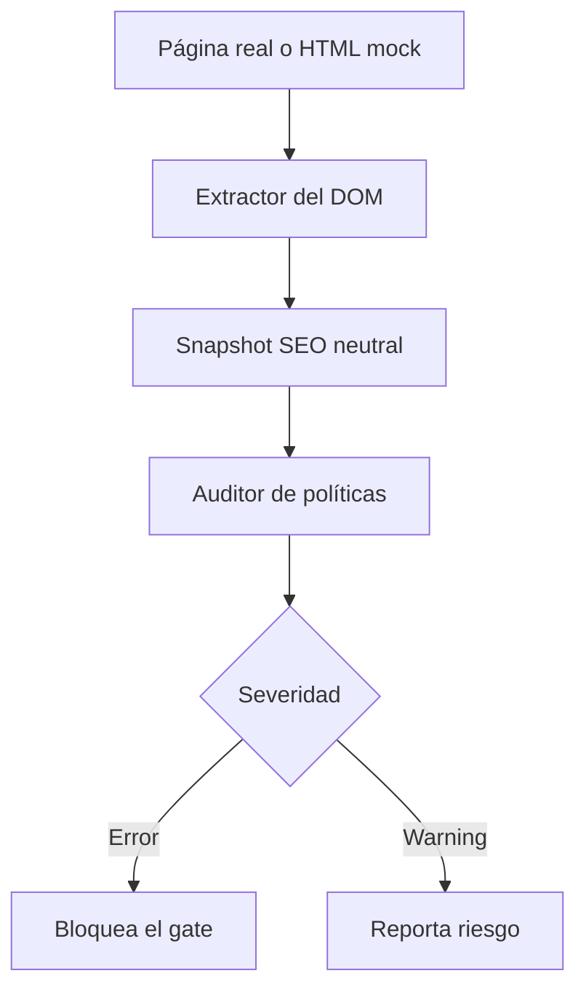

# SEO-007: International SEO Quality Engineering

Fecha: 19 de noviembre de 2026
Proyecto: Sportland SEO Quality
Estado: Implementado y validado

## 1. Objetivo

Construir un módulo automatizado que evalúe las señales SEO internacionales de Sportland MX para los mercados:

- México: `mx-default`
- Estados Unidos: `en-US`
- Alemania: `de-DE`

El módulo debe distinguir entre:

- Errores técnicos que pueden afectar indexación o consolidación de señales.
- Advertencias editoriales que representan oportunidades de localización.
- Resultados correctos que no requieren acción.

## 2. Problema de calidad

Publicar rutas para diferentes mercados no garantiza que la implementación internacional sea correcta.

Cada variante debe comprobar:

- Respuesta HTTP correcta.
- URL final esperada.
- Idioma declarado mediante `<html lang>`.
- Canonical autorreferencial.
- Alternativas `hreflang`.
- Referencia `x-default`.
- Coherencia entre los tres mercados.
- Localización básica del título.

Una página puede tener una configuración técnica correcta y, al mismo tiempo, conservar contenido sin traducir.

## 3. Arquitectura



La arquitectura separa observación, evidencia y decisión.

## 4. Componentes

| Componente | Responsabilidad |
|---|---|
| `services/international-seo-extractor.ts` | Extraer señales desde el DOM |
| `services/international-seo-auditor.ts` | Evaluar snapshots contra una expectativa |
| `tests/unit/international-seo-auditor.unit.spec.ts` | Validar la política con datos controlados |
| `tests/mock/international-seo-extractor.mock.spec.ts` | Validar la extracción usando HTML simulado |
| `tests/audit/international-seo.audit.spec.ts` | Orquestar la auditoría sobre Sportland real |

## 5. Snapshot neutral

El extractor devuelve evidencia sin decidir si es correcta:

- Mercado
- URL solicitada
- URL final
- Estado HTTP
- Idioma del documento
- Título
- Canonicals
- Alternativas hreflang

El auditor recibe posteriormente ese snapshot y aplica las reglas.

Esta separación permite probar la política sin navegador y probar el navegador sin duplicar la política.

## 6. Estrategia de pruebas

| Nivel | Casos | Propósito |
|---|---:|---|
| Unitario | 7 | Validar reglas, severidades y bloqueos |
| Browser mock | 3 | Verificar la extracción del DOM |
| Live audit | 4 | Evaluar rutas reales por tipo de página |
| Regresión general | 55 | Confirmar que SEO-007 no rompe módulos anteriores |

La ejecución de la auditoría reportó 36 pruebas porque Playwright ejecutó también sus dependencias:

- 31 pruebas unitarias generales.
- 1 setup del mercado México.
- 4 auditorías live.

SEO-007 aporta directamente 14 casos: 7 unitarios, 3 mock y 4 live.

## 7. Matriz de cobertura live

| Clúster | Tipo | Mercados |
|---|---|---|
| Hub de tecnologías | Página informativa | MX, US, DE |
| Artículo SoftFoam | Artículo editorial | MX, US, DE |
| Colección SoftFoam | Colección comercial | MX, US, DE |
| Adidas Advantage K | Producto | MX, US, DE |

Cada clúster genera tres snapshots y se evalúa como una sola unidad internacional.

## 8. Política de severidad

### Error

Un error representa un incumplimiento técnico del contrato internacional.

Ejemplos:

- Estado HTTP no aceptable.
- Redirección hacia una URL inesperada.
- `html lang` incorrecto.
- Canonical ausente, duplicado o incorrecto.
- Alternativa hreflang ausente o incorrecta.
- Mercado esperado ausente.

Los errores establecen:

```text
blocksGate = true
```

### Warning

Un warning representa un riesgo que debe reportarse, pero que todavía no justifica bloquear el flujo.

Ejemplo:

- Los tres mercados publican el mismo título y podría faltar traducción.

Los warnings establecen:

```text
blocksGate = false
```

## 9. Resultados observados

| Tipo de página | Errores | Warnings | Resultado |
|---|---:|---:|---|
| Hub de tecnologías | 0 | 0 | Localización correcta |
| Artículo SoftFoam | 0 | 0 | Localización correcta |
| Colección SoftFoam | 0 | 1 | Título idéntico en los tres mercados |
| Producto Adidas | 0 | 1 | Título idéntico en los tres mercados |

## 10. Hallazgo principal

La infraestructura SEO internacional de las rutas auditadas es correcta:

- Las páginas responden con estado 200.
- Los idiomas declarados son `es`, `en` y `de`.
- Cada página tiene un canonical.
- Los clústeres incluyen `x-default`, `es`, `en-US` y `de-DE`.
- No se detectaron errores que deban bloquear el gate.

Sin embargo, las páginas comerciales analizadas conservan títulos en español para Estados Unidos y Alemania.

Esto representa una brecha de localización editorial, no una falla de infraestructura.

## 11. Riesgo de negocio

Los títulos sin traducir pueden afectar:

- Relevancia percibida en resultados de búsqueda.
- CTR orgánico en Estados Unidos y Alemania.
- Confianza del usuario.
- Coherencia entre idioma, contenido y mercado.
- Capacidad de monetización internacional.

La prioridad debe evaluarse según el peso comercial real de cada mercado.

## 12. Decisiones de Quality Engineering

### Separar extractor y auditor

El extractor observa.
El auditor decide.

Esto reduce acoplamiento y permite pruebas rápidas y deterministas.

### Conservar duplicados durante la extracción

El extractor no corrige el DOM. Si existen dos canonicals o dos hreflang iguales, ambos deben llegar al auditor para que pueda detectarlos.

### Usar mocks para el DOM

Las pruebas mock validan selectores, normalización de URLs y duplicados sin depender de Shopify, Cloudflare o la red.

### Usar navegador para la auditoría live

Las rutas de productos pueden responder con `429` a clientes HTTP automatizados y funcionar correctamente en un navegador real.

Por eso la auditoría live usa Chromium y evalúa el comportamiento del cliente relevante.

### No bloquear por traducciones pendientes

Una traducción pendiente es importante, pero no equivale a canonical roto, hreflang incorrecto o página inaccesible.

La severidad debe representar el riesgo real.

## 13. Quality gate

El gate rápido de Pull Request ejecuta las pruebas unitarias y las pruebas browser mock.

Las auditorías `*.audit.spec.ts` permanecen separadas porque:

- Dependen del sitio real.
- Son más sensibles a red y disponibilidad externa.
- Cubren una muestra más amplia.
- No deben volver inestable el gate rápido.

La auditoría live puede ejecutarse manualmente o mediante una tarea programada independiente.

## 14. Comandos de validación

Validar TypeScript:

```bash
npx tsc --noEmit
```

Ejecutar pruebas unitarias:

```bash
npx playwright test --project=unit
```

Ejecutar el extractor con navegador y HTML simulado:

```bash
npx playwright test \
  tests/mock/international-seo-extractor.mock.spec.ts \
  --project=chromium
```

Ejecutar la auditoría internacional live:

```bash
npx playwright test \
  tests/audit/international-seo.audit.spec.ts \
  --project=sitemap-audit
```

Ejecutar el quality gate completo de Chromium:

```bash
npx playwright test --project=chromium
```

Abrir el reporte:

```bash
npx playwright show-report
```

## 15. Limitaciones conocidas

- La auditoría usa una muestra representativa y no las 1,702 URLs descubiertas.
- Un título idéntico no siempre implica un defecto; algunos nombres de producto pueden ser universales.
- No se evalúa todavía la traducción del contenido completo.
- No se validan descripciones meta internacionales.
- No se valida moneda, disponibilidad o precio por mercado.
- No se revisan datos estructurados internacionales.
- La auditoría live depende de Shopify y de la red.

## 16. Posibles extensiones

- Añadir validación de meta descriptions.
- Comparar idioma del contenido visible.
- Auditar datos estructurados por mercado.
- Validar moneda y disponibilidad regional.
- Seleccionar rutas internacionales desde el sitemap.
- Programar una auditoría periódica fuera del gate rápido.
- Exportar findings a JSON o HTML.
- Elevar warnings recurrentes a errores cuando exista una política comercial aprobada.

## 17. Definition of Done

SEO-007 se considera terminado cuando:

- TypeScript compila sin errores.
- La política tiene cobertura unitaria.
- El extractor tiene pruebas browser mock.
- La auditoría live cubre diferentes tipos de página.
- Los errores técnicos bloquean.
- Las advertencias editoriales se reportan.
- La regresión completa permanece verde.
- El Pull Request supera el quality gate.
- El módulo queda documentado.

## 18. Preguntas de estudio

1. ¿Por qué el extractor no debe decidir si una señal es correcta?
2. ¿Qué diferencia existe entre una prueba mock y una auditoría live?
3. ¿Por qué un warning no bloquea el gate?
4. ¿Por qué se prueban varios tipos de página?
5. ¿Qué riesgo representa un título en español dentro del mercado alemán?
6. ¿Por qué una respuesta `429` de un cliente HTTP no demuestra que el producto esté roto?
7. ¿Por qué las auditorías live se mantienen fuera del gate rápido?
8. ¿Cuándo debería elevarse un warning a error?

## 19. Trazabilidad

Commits principales:

- `8bd6733`: política de señales SEO internacionales.
- `3e23ed0`: extracción de señales desde el DOM.
- `4ebf96f`: auditoría live de mercados.
- `3128d6d`: ampliación por tipo de página.

Este historial permite revisar cada decisión como una unidad independiente.
